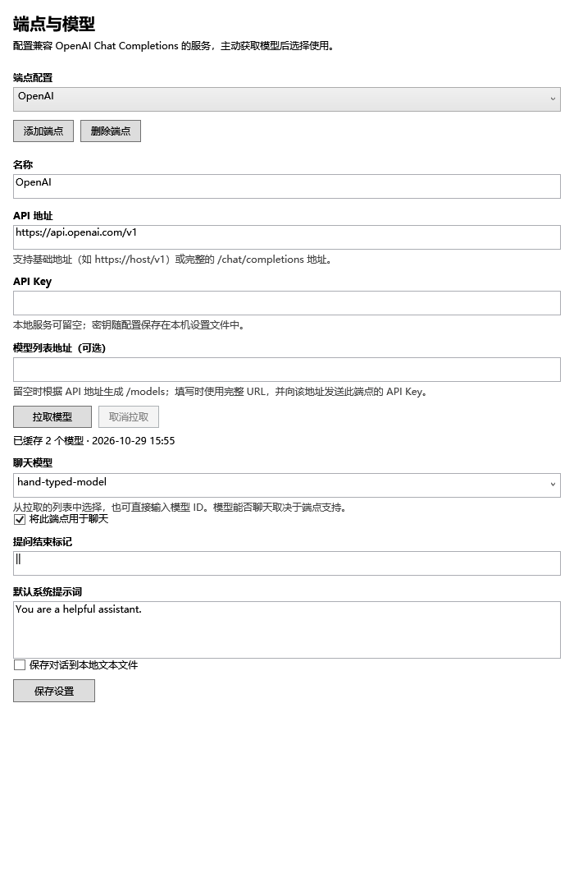

# ChatGPT Models

[English](README.md) | [简体中文](README.zh-CN.md)

在 Flow Launcher 中使用兼容 OpenAI 的聊天服务，在原生设置面板中拉取模型并选择使用。

**作者：liboy** · **版本：1.0.0** · **许可证：MIT**

## 功能

- 多端点配置：每个端点独立保存地址、密钥、模型列表和所选模型。
- 主动拉取模型，下拉选择或手动输入模型 ID。
- 拉取失败、空列表或取消时，保留原有缓存和选择。
- 自定义模型列表地址、系统提示词、提问结束标记。
- 复制回答、在文本编辑器打开，以及可选的本地对话保存。

当前设置界面为简体中文。提问和回答可以使用模型支持的任意语言。



## 环境要求

Windows，Flow Launcher **2.1.3 或更新版本**。插件采用 C# / WPF，目标框架为 .NET 9；运行安装包无需 Python。

服务需要支持 OpenAI 格式的 **Chat Completions**（`POST /chat/completions`）。模型列表使用 `GET /models`，响应格式为 `data[].id`。暂不支持仅提供 Responses 的服务或 Anthropic 原生协议。

## 安装

Release 发布后，从 [GitHub Releases](https://github.com/liboysoft/Flow.Launcher.Plugin.ChatGPTModels/releases) 下载插件 ZIP，或在 Flow Launcher 输入：

```text
pm install https://github.com/liboysoft/Flow.Launcher.Plugin.ChatGPTModels/releases/download/v1.0.0/Flow.Launcher.Plugin.ChatGPTModels.zip
```

当前本地准备步骤尚未提交 Flow 插件市场审核；审核上架后也可直接从商店安装。

## 配置与使用

1. 打开 Flow Launcher 设置 → 插件 → **ChatGPT Models**。
2. 选择或添加端点，填写名称、API 地址及 API Key；本地服务允许时可留空密钥。
3. 点击 **拉取模型**，在 **聊天模型** 下拉框中选择，或手动填写模型 ID。
4. 勾选 **将此端点用于聊天**，点击 **保存设置**。
5. 输入问题，并以结束标记结尾，默认是 `||`：

```text
ai 英镑的符号是什么 ||
ai short 解释一下 DNS ||
ai long 解释一下 DNS ||
```

API 地址支持 `https://host/v1`、完整的 `https://host/v1/chat/completions`、本地 HTTP 地址及自定义路径前缀。只有域名时默认添加 `/v1`。模型列表地址留空时自动生成 `/models`；也可填写完整的自定义模型目录地址，该地址会收到此端点的 API Key。

拉取成功后不会自动更换模型；请选择模型并保存。修改地址或密钥后会清除旧模型列表，保留已填写的模型 ID。返回列表可能包含图片、嵌入等模型，请选择支持聊天的模型。

可在已安装插件目录中添加 UTF-8 格式的 `system_messages.csv` 自定义提示词关键词，随后重载插件。格式为带表头、以分号分隔的关键词及系统提示词两列，支持 CSV 引号转义。

## 数据保存与迁移

密钥保存在本机插件设置 JSON 中，请勿上传设置文件或真实密钥。对话保存默认关闭，开启后写入插件设置目录中的 `Conversations.txt`。

本公开版本使用独立插件 ID 和程序集名，与原版及此前本地测试版分别保存设置。迁移时先退出 Flow Launcher，备份旧 `Settings.json`，再复制到新插件的 `Flow.Launcher.Plugin.ChatGPTModels` 设置目录。也支持读取原 Python 版的设置格式。新旧插件默认关键词均为 `ai`，同时安装时请为其中一个更改关键词。

## 构建与测试

安装 .NET 9 SDK 和 Flow Launcher，然后在 PowerShell 执行：

```powershell
dotnet run --project tests/Tests.csproj -c Release
.\build.ps1
# 便携版或自定义安装位置：
.\build.ps1 -FlowLauncherDirectory 'D:\Apps\FlowLauncher'
```

输出为 `artifacts/Flow.Launcher.Plugin.ChatGPTModels.zip`，构建不会自动安装。测试使用模拟 HTTP 响应和真实 WPF 控件，无需 API 密钥；布局预览输出到 `artifacts/settings-preview.png`。

当前入口在 `src/`。仓库中的原 Python 文件、`lib/` 和旧设置模板仅作为参考保留，不包含在发布安装包中。

## 常见问题

模型列表可拉取不代表聊天接口可用。聊天返回 HTTP 404 时，请检查 API 地址是否指向实际模型服务，以及反向代理是否把聊天请求转发到正确后端；修改模型列表地址不能修复不存在的聊天路由。插件会分别提示认证失败、限流、网络错误和超时。

## 开源发布与上架

详见 [PUBLISHING.md](PUBLISHING.md)。项目已准备标签触发的自动构建及 GitHub Release 工作流，以及 `publishing/` 下的市场提交清单。

## 致谢与许可证

基于 [MichielvanBeers/Flow.Launcher.Plugin.ChatGPT](https://github.com/MichielvanBeers/Flow.Launcher.Plugin.ChatGPT) 改进，保留原项目署名，修改部分作者为 liboy。详见 [LICENSE](LICENSE)。

ChatGPT / OpenAI 图标归 OpenAI 所有，来源见 [Images/NOTICE.txt](Images/NOTICE.txt)。本项目为独立社区插件，与 OpenAI 无隶属或官方背书关系。
